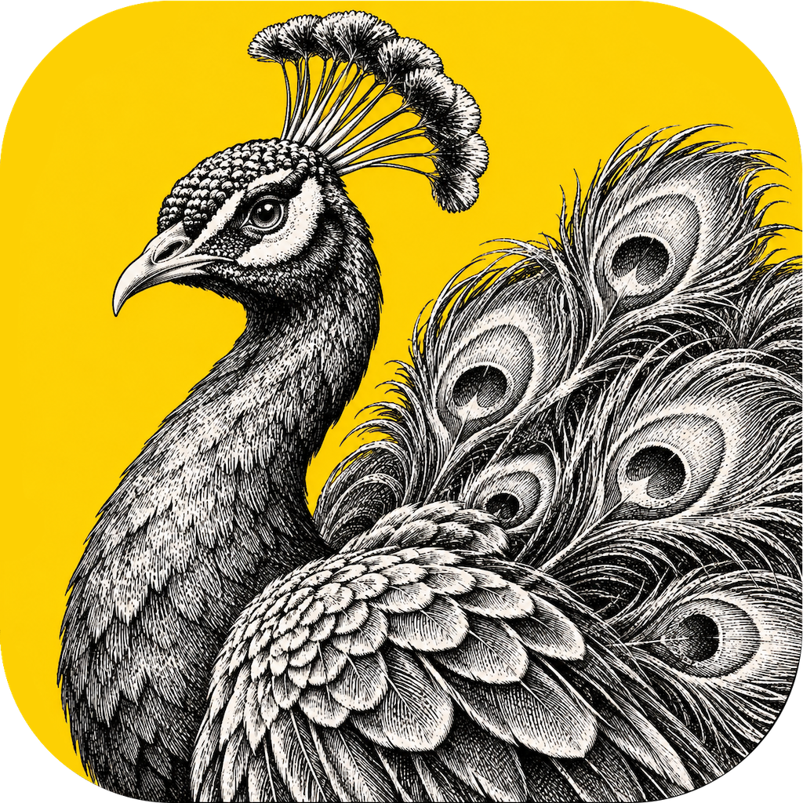
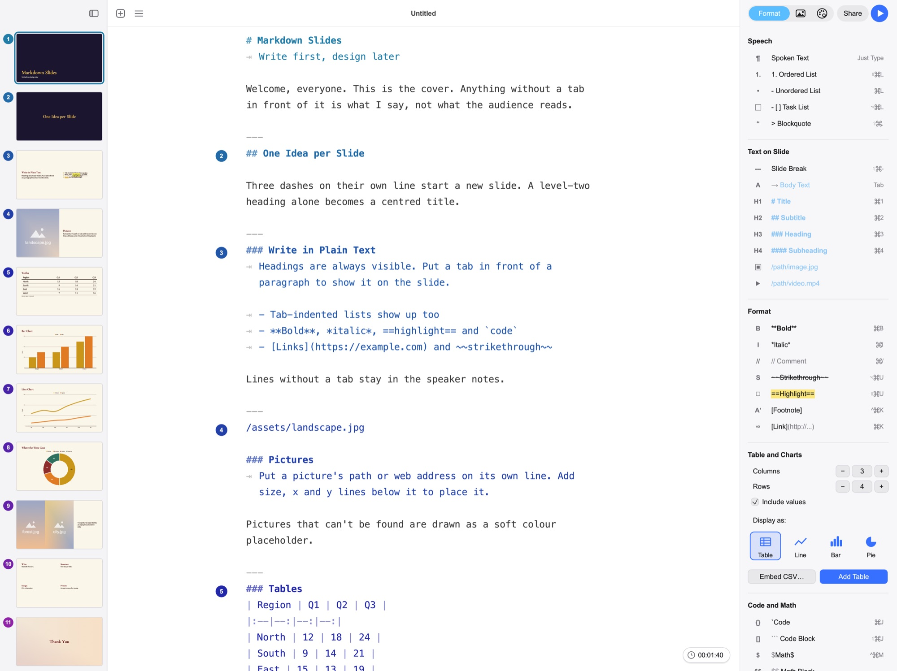
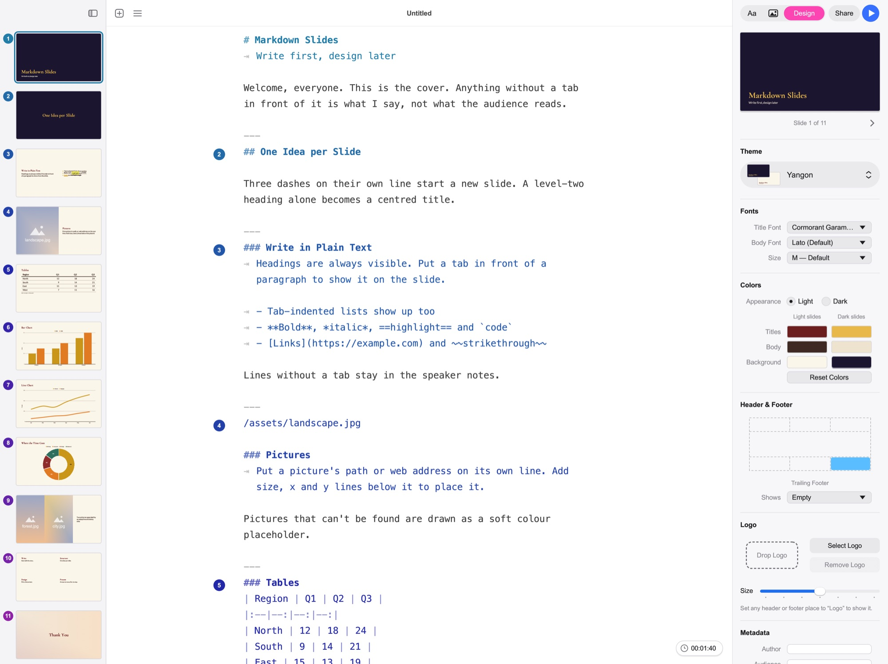

<p align="center">
  
</p>

<h1 align="center">PresentCraft</h1>

<p align="center">
  <b>Write your talk in Markdown. Design it in one click. Present or export it anywhere.</b><br>
  A native presentation editor for macOS, Windows and Linux, built in Rust.
</p>

<p align="center">
  <a href="https://github.com/saturngod/PresentCraft/releases"><b>Download</b></a> ·
  <a href="#features">Features</a> ·
  <a href="#themes">Themes</a> ·
  <a href="#build-from-source">Build from source</a> ·
  <a href="#for-ai-agents">AI agents</a>
</p>

<p align="center">
  
</p>

## Features

- **Write first, design later.** One Markdown script holds the slides and your speaker notes. Text with a tab in front shows on the slide; the rest stays in your notes.
- **Rich slides.** Pictures, videos, tables, line, bar and pie charts, code, math and footnotes.
- **Themes.** 24 built-in themes, background gradients, logos, headers and footers. Import or make your own.
- **Present and export.** Present full screen, or export to PDF, PowerPoint, images or HTML. Videos play in HTML and PowerPoint, YouTube videos included.
- **Native and offline.** No Electron, no account. Presentations are `.prcraft` packages on your own disk.

<p align="center">
  
</p>

## Download

Get the latest build for macOS, Windows or Linux from [Releases](https://github.com/saturngod/PresentCraft/releases). Release packages include FFmpeg, so videos work without installing anything.

## Themes

The built-in themes are named after Southeast Asian cities, with colours and fonts drawn from each one.

| Theme | Look | Titles / body |
| --- | --- | --- |
| Yangon | Lacquer maroon on ivory; gold on twilight indigo. Covers in the dark look. | Cormorant Garamond / Lato |
| Mandalay | Royal vermilion on warm paper; gilded titles on teak. | Cinzel / EB Garamond |
| Bagan | Dawn gradient, a new colour per slide: rose, apricot, amber; brick to dusk plum when dark. | Marcellus / Nunito Sans |
| Taunggyi | Pine green on highland mist; covers in night-sky navy with balloon-flame titles. | Fraunces / Nunito Sans |
| Singapore | Singapore red on crisp white; covers in night-bay navy. | Space Grotesk / Inter |
| Bangkok | Jewel-tone gradient (emerald, sapphire, ruby, gold) with white titles. | Prompt / Sarabun |
| Chiang Mai | Forest green on morning mist; lantern orange on a night sky. | Lora / Source Sans 3 |
| Hanoi | Shutter green on mustard; covers in deep green with mustard titles. | Be Vietnam Pro / Be Vietnam Pro |
| Hoi An | Silk-lantern gradient; deep silk tones by default, lantern glow when light. | Playfair Display / Mulish |
| Da Nang | Sea gradient, sky blue into lagoon green; deep water with gold titles when dark. | Be Vietnam Pro / Mulish |
| Kuala Lumpur | Navy on cool white; steel on a city night, with songket gold. | Archivo / IBM Plex Sans |
| Penang | Peranakan pastel gradient (pink, peach, mint, lilac); jewel tones when dark. | Fraunces / Karla |
| Malacca | Terracotta red on lime-wash white; warm clay on deep maroon, with tile blue. | Libre Baskerville / Lato |
| Siem Reap | Temple brown on sandstone; covers in pre-dawn blue with sunrise titles. | Spectral / Kantumruy Pro |
| Phnom Penh | Royal blue on palace cream; roof gold on royal blue. | Marcellus / Kantumruy Pro |
| Luang Prabang | Saffron on temple white and on dark teak. | Libre Baskerville / Work Sans |
| Vientiane | Dusk plum on frangipani white; champa yellow on Mekong dusk. | Lora / Karla |
| Bali | Terrace greens to ripe gold; deep jungle greens when dark. | DM Serif Display / DM Sans |
| Jakarta | White on graphite with one Betawi orange accent; graphite on warm white when light. | Poppins / Inter |
| Yogyakarta | Batik sogan brown on cream; covers in indigo with wax-gold titles. | Playfair Display / Source Sans 3 |
| Manila | Sunset gradient from bay blue to gold, white titles. | Oswald / Poppins |
| Cebu | Mango into reef-green gradient; deep reef with mango titles when dark. | Oswald / DM Sans |
| Bandar Seri Begawan | Black on marble white; covers in black with dome-gold titles. | Cormorant Garamond / Work Sans |
| Dili | Hill green on sea-mist white; sandalwood on forest night, with tais red. | Space Grotesk / IBM Plex Sans |

## Build from source

You need a stable Rust toolchain ([rustup](https://rustup.rs)) and your platform's build tools (Xcode Command Line Tools, Visual Studio Build Tools, or a C toolchain with X11/Wayland packages on Linux).

```sh
cargo run --locked --bin PresentCraft                          # opens the sample deck
cargo run --locked --bin PresentCraft -- path/to/talk.prcraft  # or a .md file
cargo build --locked --release                                 # optimized build in target/release/
```

For video when running from source, install `ffmpeg` (`brew install ffmpeg`, `winget install ffmpeg`, or your Linux package manager).

YouTube links (``) show the video's preview picture and, while presenting, play in YouTube's own player over the slide (the system's web view on macOS and Windows; on Linux they open in the browser). Settings → Presentation → Content has Auto play and Show controls for all videos.

## For AI agents

The [`create-prcraft`](Skills/create-prcraft/SKILL.md) skill lets Claude Code, Codex and the Claude apps write `.prcraft` presentations. [`Skills/README.md`](Skills/README.md) shows how to install it. Its helper script needs only Python 3:

```sh
python3 Skills/create-prcraft/scripts/prcraft.py build talk.md Talk.prcraft --theme Bagan
python3 Skills/create-prcraft/scripts/prcraft.py check Talk.prcraft
```

PresentCraft also runs an [MCP server](docs/mcp-server.md), so an AI client can work in the open window: write slides, change themes, colours and fonts, add pictures and logos, set headers and footers, export and present. Choose **File › MCP › Start Server** to turn it on. Then add it to your client, for example:

```sh
claude mcp add presentcraft -- /path/to/PresentCraft --mcp
```

## Documentation

- [Document and theme format](docs/format.md): packages, media, videos in exports, theme folders, file types.
- [Development](docs/development.md): tests, screenshots, launch options, project layout, icons.
- [Releases](release.md): building packages and publishing a release.
